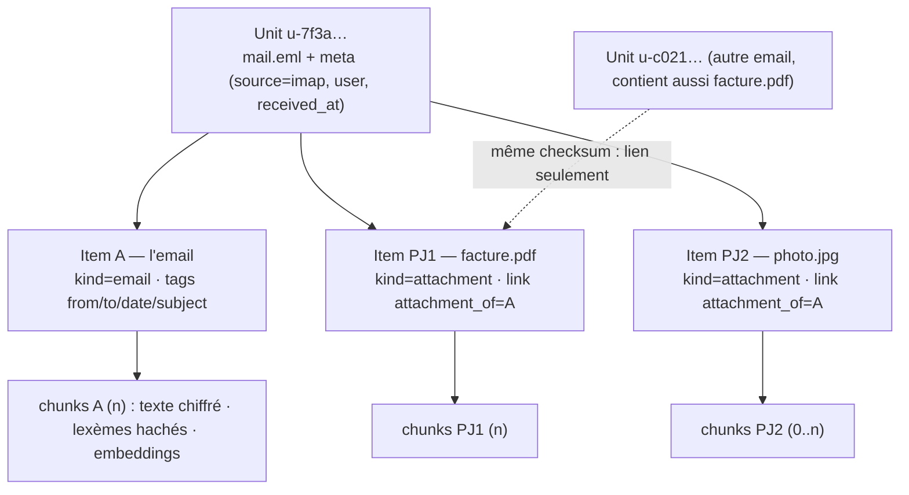
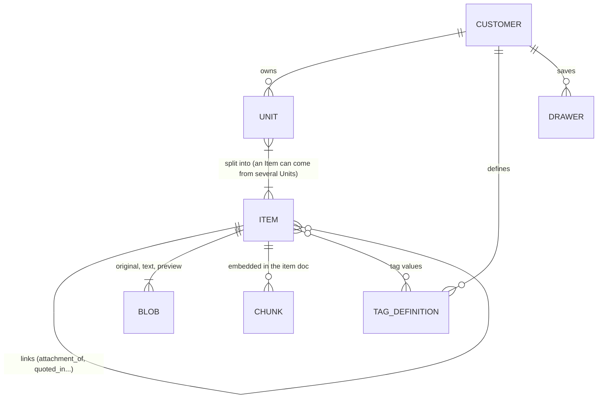
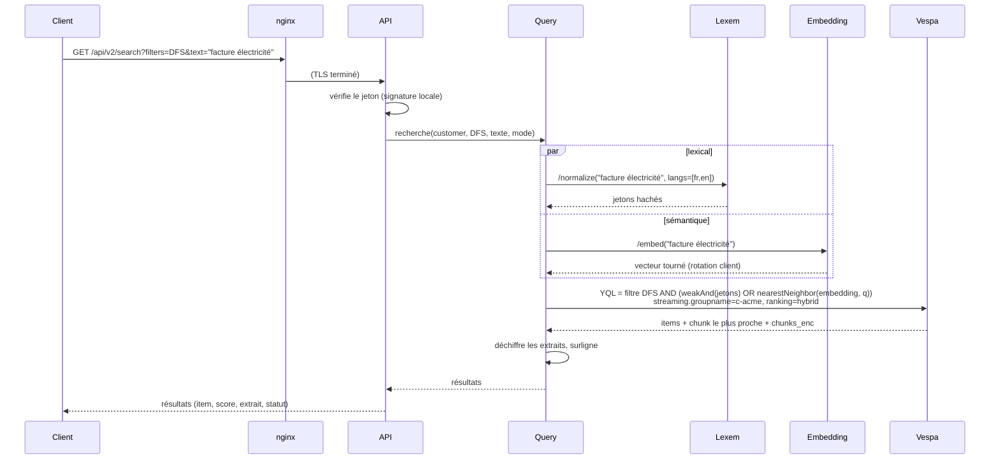
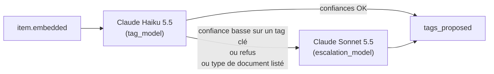
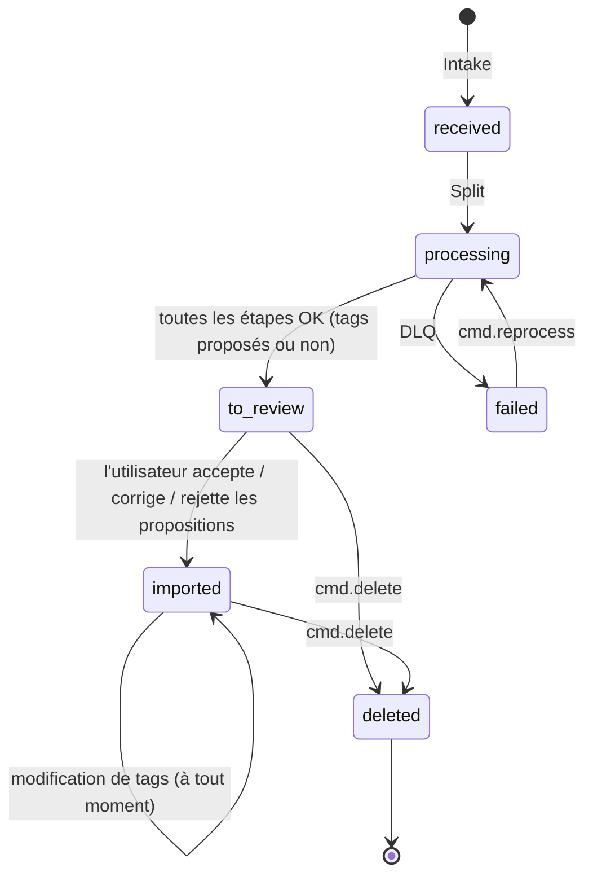
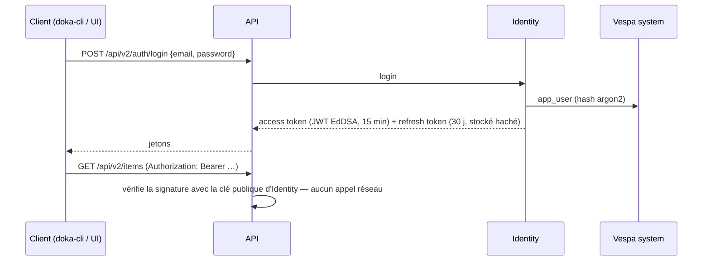
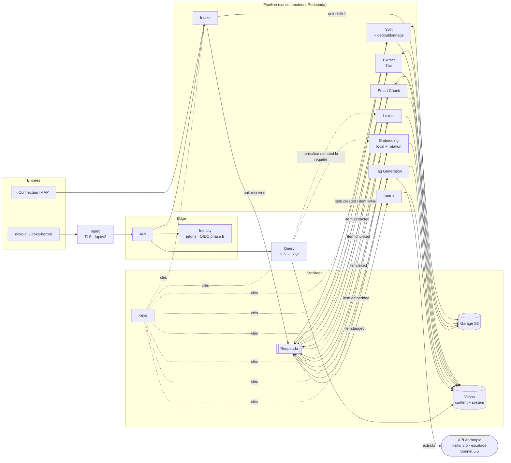

# Doka « The Spirit Within » — Architecture cible

> **Statut** : v0.2, document de discussion (2026-11-14). La v0.2 intègre les décisions du §2.
> **Sources** : les croquis transcrits dans [README.md](README.md) (`01_data_model`, `02_architecture`), le code Doka actuel (branche `main`), les specs `_ai/F0001` → `F0007` et la note `wiki/prospection/email-parsing.md`.
> Les passages marqués **[PoC]** reposent sur des capacités de Vespa qu'il faut vérifier par un prototype avant de s'engager. Les questions encore ouvertes sont regroupées au §18.

---

## 1. En une page

Doka devient une **chaîne de traitement par événements**. Une entrée brute (un **Unit**, par exemple un `.eml`) arrive par **nginx**, est déposée chiffrée dans un stockage objet S3 (**Garage**), puis un message court dans **Redpanda** (le « Kafka Lite » du croquis) déclenche une suite de services spécialisés, un par étape :

```
Intake → Split → Extract (Tika) → Smart Chunk → { Lexem , Embedding } → Tag Generation (Claude)
```

Le schéma complet de tous les services est au §17.

Chaque service lit ce dont il a besoin dans Garage. Il écrit ses propres champs dans **Vespa**, qui remplace PostgreSQL et devient l'unique base de données et le moteur de recherche. Il publie enfin un message court pour l'étape suivante.

Principes directeurs :

1. **Messages courts, données lourdes ailleurs** (*claim-check*) : un message contient des identifiants et des références S3, jamais le contenu.
2. **Un service = une étape = un groupe de consommateurs** : chaque étape se met à l'échelle seule, selon le retard (*lag*) de son topic.
3. **Idempotence partout** : les identifiants sont déterministes (calculés à partir du contenu) et les écritures Vespa sont des mises à jour partielles rejouables. Rejouer un message ne produit jamais de doublon.
4. **Garage est la source de vérité, Vespa est une projection** : on peut toujours reconstruire l'index à partir des Units.
5. **Le chiffrement reste l'ADN de Doka** : le contenu est chiffré en ChaCha20 et le plein texte est cherchable via des lexèmes hachés (*blind index*). Seule exception, assumée et explicite : le texte envoyé à Claude pour proposer des tags (§11.4).

---

## 2. Décisions prises (2026-11-14)

| # | Sujet | Décision | Effet sur l'architecture |
|---|---|---|---|
| 1 | `LX` du croquis | Ne veut rien dire. Le point d'entrée est un **reverse proxy nginx**. | nginx devant le service **API** (§12.1). |
| 2 | « Kafka Lite » | Redpanda s'il est gratuit, sinon Kafka. Redpanda Community (licence BSL) est gratuit, y compris en production : la seule restriction est de ne pas revendre Redpanda comme service de streaming. → **Redpanda**. | Le contrat reste le protocole Kafka : on bascule sur Apache Kafka (KRaft) sans changer de code (§7.1). |
| 3 | Volumétrie | 30 emails + 20 documents par jour **et par utilisateur**, 20 utilisateurs, soit ≈ 1 000 Units par jour. | Charge **faible** : un seul nœud de chaque brique suffit pour tenir la charge. Le multi-nœud ne sert qu'à la haute disponibilité (§14). Le poste de coût notable est Claude (§9.2). |
| 4 | Pièce jointe déjà connue | Checksum de chaque Item ; si l'Item existe déjà, **on le réutilise** et on ajoute seulement un lien. | `item_id` est calculé à partir du contenu ; le Split fait « lier au lieu de créer » (§5.3). |
| 5 | Embeddings | Modèle **local imposé** + **rotation secrète par client**. | Service Embedding (§6.2) et §11.3. |
| 6 | Tags cachés | **Non** : pas de tags hachés ou chiffrés, les valeurs de tags restent en clair. | Toutes les opérations DFS restent possibles sur tous les tags. |
| 7 | LLM pour les tags | **Claude** (API Anthropic), clé fournie par variable d'environnement. Choix initial : Sonnet 5.5. **Révisé le même jour** : **Haiku 5.5 par défaut**, escalade ciblée vers Sonnet 5.5, à valider par un banc d'essai. | Service Tag Generation (§9.2) ; ≈ 100 à 200 $ par mois au lieu de 600 à 900 $ ; le texte d'extraits sort de l'infrastructure (§11.4). |
| 8 | Items « à valider » visibles ? | Choix laissé à l'architecture. | Visibles dès la fin du traitement ; les tags proposés ne sont cherchables qu'une fois acceptés (§9.4). |
| 9 | API | Nouvelle URL **`/api/v2`** ; on peut retoucher les routes, en gardant l'idée centrale de chacune. | §12. |
| 10 | Authentification | **Jetons signés**, puis **OIDC**, en **deux phases séparées**. | §13 ; jalons M1 et M6 distincts (§19). |

---

## 3. Ce qu'on garde de Doka

| Capacité Doka actuelle | Où elle vit aujourd'hui | Où elle vit dans « The Spirit Within » |
|---|---|---|
| Multi-clients (un schéma PG par client `cs_<customer>` / `fs_<customer>`) | admin-server + PostgreSQL | Un **groupe Vespa par client** (mode *streaming*), un préfixe S3 par client, une clé par client |
| Chiffrement ChaCha20 des fichiers, en blocs de 1 Mo | file-server → `file_parts` (PG) | Services **Intake** / **Split** → objets chiffrés dans **Garage** |
| Extraction de texte et de métadonnées via Tika | file-server → tika-server | Service **Extract** (pool de Tika) |
| Plein texte chiffré (`tsvector` dont chaque lexème est haché avec la clé client) | document-server `fulltext.rs`, table `document` | Service **Lexem** → champ de lexèmes hachés dans Vespa, classé par BM25 |
| Items + tags typés (`string`, `int`, `double`, `date`, `datetime`, `bool`, `link`) | `item`, `tag_definition`, `tag_value` | Document Vespa `item` avec des maps typées |
| Items sans fichier (un Item défini seulement par ses propriétés, `doka-cli item create`) | `POST /item` | `POST /api/v2/items` (Item « virtuel », sans blob ni pipeline) |
| Tags multi-valués avec vocabulaire fermé (F0006/F0007 : `ANY`, `ALL`, `NONE`, `IS`, wildcards `%`) | spécifiés, pas encore implémentés | Champs `tags_multi` et `tags_multi_sig` dans Vespa, avec la traduction DFS → YQL (§8.3) |
| Langage de filtre DFS (`==`, `LIKE`, `AND`/`OR`, échappements `#`, dates F0005) | lexer/parser du document-server | **Conservé tel quel** ; seul le générateur change (SQL → YQL) |
| « Drawers » = recherches sauvegardées (`compiled_query`) | document-server | Document Vespa `drawer` (on stocke le DFS, plus le SQL compilé) |
| Tags proposés, puis validés par l'utilisateur (état « imported ») | `wiki/readme.md` (intention) | Service **Tag Generation** (Claude) + boîte « à valider » (§9) |
| Ingestion IMAP (sujet principal, pièces jointes, sous-emails, dédoublonnage par checksum) | imap-plugin, `email-parsing.md` | **Connecteur IMAP** qui produit des Units ; le **Split** fait le découpage et le dédoublonnage |
| Sessions, clés client, sysadmin | session-manager, key-manager, admin-server | **Identity** (jetons signés, puis OIDC) et **Keys** ; données dans le cluster Vespa `system` |
| Suivi d'upload (`/loading`, `upload_watch` dans doka-harbor) | file-server, doka-harbor | Service **Status** + flux SSE `/api/v2/events` |
| Corrélation des logs (`x_request_id`, `follower`) | tous les services | Champ `correlation_id` propagé dans chaque message + OpenTelemetry |

---

## 4. Vocabulaire

| Terme | Définition |
|---|---|
| **Unit** | Ce qui entre dans Doka, tel quel : un `.eml`, un PDF, un zip, une photo… accompagné de **métadonnées simples** (source, utilisateur, date de réception, nom d'origine, type MIME annoncé). Un Unit est immuable. |
| **Item** | Un objet métier obtenu après le **Split** d'un Unit. Un email avec 2 pièces jointes (PJ) donne 3 Items : le mail et PJ1, PJ2. Un Item = **meta + blobs + tags**. C'est l'objet que l'utilisateur voit, tague et cherche. Un même Item peut provenir de plusieurs Units (la même PJ reçue deux fois). |
| **Blob** | Un contenu binaire chiffré dans Garage : l'original de l'Item, le texte extrait, un aperçu… |
| **Chunk** | Un segment du texte d'un Item, taillé pour la recherche lexicale et sémantique. Un chunk porte un texte chiffré, des lexèmes hachés et un embedding. |
| **Tag** | Un attribut typé posé sur un Item. Une `tag_definition` (par client) fixe le nom, le type, une description et, pour le type `multi`, le vocabulaire `predef_values`. |
| **Tag proposé** | Un tag suggéré par Claude ou extrait automatiquement, que l'utilisateur n'a pas encore accepté (§9). |
| **Link** | Une relation dirigée entre Items (`attachment_of`, `reply_to`, `quoted_in`…). Elle généralise le tag `link` actuel. |
| **Drawer** | Une recherche DFS sauvegardée, qui peut avoir des niveaux de regroupement. |
| **Stage** | Une étape de traitement d'un Item (`split`, `extract`, `chunk`, `lexem`, `embed`, `tag`). |

---

## 5. Modèle de données

### 5.1 Exemple : un email avec 2 pièces jointes



### 5.2 Entités



### 5.3 Identifiants déterministes et dédoublonnage

| Objet | Identifiant | Pourquoi |
|---|---|---|
| Unit | `u-` + `HMAC(k_id, octets bruts du Unit)` | Recevoir deux fois le même `.eml` donne le même Unit : le second envoi est ignoré. |
| Item | `i-` + `HMAC(k_id, octets d'origine de l'Item)` | **Décision n°4** : le checksum de l'Item **est** son identifiant. Une PJ déjà connue retombe sur le même `item_id`, ce qui garantit la réutilisation. |
| Blob | `HMAC(k_id, contenu)` | Stockage dédoublonné. |
| Chunk | `item_id` + `chunk_set_id` + rang | `chunk_set_id` change si on re-découpe, ce qui évite de mélanger deux découpages (§7.4). |

`k_id` est une sous-clé du client (§11.1). On utilise un HMAC plutôt qu'un SHA-256 nu, pour qu'un tiers ne puisse pas confirmer qu'il possède le même fichier.

**Ce que couvre le checksum d'un Item :**

- **Pièce jointe ou fichier** : les octets du fichier décodé (après base64). La même facture reçue dans deux emails donne le même Item.
- **Email** : le message **complet**, en-têtes compris (`Message-ID`, `Date`, `From`…), et pas seulement le corps. Deux emails différents dont le corps est identique (« ok merci ») restent deux Items distincts.
- **Sous-email** (message transféré ou cité) : le message embarqué complet. S'il est déjà connu, par exemple parce qu'on a aussi reçu l'original, on retombe sur l'Item existant. Cela réalise naturellement la règle « Find the original email » de `email-parsing.md`.

**Comportement du Split quand l'Item existe déjà** (option b) :

1. Pas de nouvel Item et pas de retraitement : aucun `item.created`, donc ni Tika, ni chunks, ni embeddings, ni appel à Claude.
2. Mise à jour partielle de l'Item existant : ajout de `unit_id` dans `unit_ids`, et ajout du lien (`attachment_of:<nouvel email>`) dans `links`.
3. Les tags existants de l'Item sont conservés tels quels.
4. Publication d'un `item.linked`, pour que le Status compte l'Item comme prêt pour ce Unit.

**Garde-fou « logos de signature »** : les petites images insérées dans le HTML (`cid:`, moins de 20 Ko, à paramétrer) ne deviennent **pas** des Items. Sinon, le logo de l'entreprise deviendrait un Item lié à des milliers d'emails. Ces images restent des blobs de l'email, pour son affichage.

**Suppression** : supprimer un email retire son lien sur ses PJ. Une PJ n'est supprimée que si plus aucun Unit ni Item ne la référence (comptage des `unit_ids` et des `links`).

---

## 6. Services

### 6.1 Tableau des services

| Service | Consomme | Produit | Lit | Écrit dans Vespa | Notes |
|---|---|---|---|---|---|
| **nginx** | HTTP(S) | — | — | — | TLS, routage `/api/v2` → API et `/` → UI, upload en streaming, SSE, limitation de débit (§12.1). |
| **API** | HTTP (via nginx) | `cmd.*` | Vespa (via Query), Garage (download) | tags et état de revue des `item`, `tag_definition`, `drawer` | Vérifie les jetons ; c'est le seul service exposé. |
| **Identity** | HTTP interne | — | Vespa `system` | `app_user`, `refresh_token` | Phase A : login local et jetons signés. Phase B : OIDC (§13). |
| **Keys** | HTTP interne (mTLS) | — | Vespa `system` | `customer_key` | Remplace key-manager ; clés client chiffrées par une clé maître (KEK). |
| **Intake** | HTTP, connecteurs | `unit.received` | — | `unit` | Calcule l'id, chiffre, dépose dans Garage. Seul point d'entrée des données. |
| **Split** | `unit.received` | `item.created` ou `item.linked` (×N), `unit.split` | Garage `units/` | `item` (meta, links, unit_ids), `unit.item_count` | MIME : `.eml` → email, sous-emails, PJ ; zip → entrées ; sinon 1 Item. Dédoublonnage (§5.3). |
| **Extract** | `item.created` | `item.extracted` | Garage `blobs/` | `item.lang`, `item.mime_type`, méta Tika | Pool de Tika ; texte chiffré vers `text/`. |
| **Smart Chunk** | `item.extracted` | `item.chunked` | Garage `text/` | `item.chunk_set_id`, `chunks_enc` | Découpage structurel (§6.2). |
| **Lexem** | `item.chunked` | `item.lexed` | Garage `chunks/` | `chunks_lex` | Normalisation, stemming, hachage par clé. Expose aussi `POST /normalize` (synchrone) pour le Query. |
| **Embedding** | `item.chunked` | `item.embedded` | Garage `chunks/` | `embedding`, `embedding_model` | Modèle **local**, rotation par client. Expose aussi `POST /embed` pour le Query. |
| **Tag Generation** | `item.created`, `item.embedded` | `item.tagged` | Garage `chunks/`, Vespa `tag_definition` | tags déterministes, `tags_proposed` | En-têtes et métadonnées, puis **Claude Haiku 5.5**, avec escalade vers Sonnet 5.5 (§9.2). |
| **Status** | tous les `item.*` / `unit.*` | `item.ready`, `unit.ready` | — | `item.status`, `item.stages`, `unit.status` | Calcule l'état global et alimente le flux SSE. |
| **Query** | HTTP interne | — | Vespa | — | DFS → YQL ; déchiffre les extraits ; recherche hybride. |
| **Connecteur IMAP** | (planification) | appels Intake | serveur IMAP | — | Un Unit par message ; mémorise les UID déjà vus. |

Chaque service est un binaire Rust (axum + tokio) séparé. Ils partagent les crates `dkcrypto`, `dkdto`, `commons-error` et une nouvelle crate `doka-bus` (enveloppe de message, consommateur, retries). Vu la volumétrie (décision n°3), on fournit aussi un **binaire « all-in-one »** qui lance tous les consommateurs dans un seul processus. C'est utile en dev et pour un petit déploiement : la séparation reste logique (topics, groupes de consommateurs) même si le processus est unique.

### 6.2 Détail des étapes

**Intake**

- Reçoit le flux (HTTP multipart ou connecteur) et l'écrit en streaming dans Garage (`units/<customer>/<unit_id>`), chiffré en blocs ChaCha20 (on garde la logique de blocs d'1 Mo de file-server).
- Calcule `unit_id` pendant le streaming. Si le Unit existe déjà, la réponse est `200 already_known`, sans nouvel événement.
- Écrit le document `unit` (statut `received`), **puis** publie `unit.received`. Si le service meurt entre les deux, un balayeur republie les Units restés `received` depuis plus de N minutes : c'est une forme d'*outbox* sans base transactionnelle.

**Split**

- `.eml` : parse MIME (crate `mail-parser`). Il produit l'email (texte et/ou HTML, décodage quoted-printable), les **sous-emails** et les **PJ**, avec la règle de dédoublonnage du §5.3.
- Pose les **links** (`attachment_of`, `reply_to` via `In-Reply-To`/`References`, `quoted_in`).
- Archives (zip, tar) : récursion bornée en profondeur, en taille et en nombre d'entrées (protection contre les zip bombs).

**Extract**

- Utilise **Tika 4.1.0**, dernière version stable, à la place de la 2.2.0 lancée par `tika.sh`.
- Demande une sortie **structurée**, qui garde les titres, les paragraphes et les tableaux, au lieu du texte brut :
  - **Markdown**, la sortie par défaut de `/tika` et `/rmeta` depuis Tika 4.x ;
  - ou **XHTML**, via `/tika/xml` ou `/rmeta/xml`.

  À choisir sur nos documents réels. Point à vérifier : pour un PDF, Tika ne retrouve probablement que les pages et les paragraphes, pas de vrais titres ni tableaux.
- Récupère texte et métadonnées en un seul appel (`/rmeta`), comme le faisait `/tika/text` en JSON (cf. `todo.md`).
- Détecte la langue, et la stocke par Item.
- OCR (images, PDF scannés) en option, via une file séparée `item.ocr` pour ne pas bloquer le flux principal.

**Smart Chunk**

- Découpe *selon la structure* fournie par Tika (Markdown ou XHTML) plutôt qu'à taille fixe : titres, paragraphes, pages. **Un tableau n'est jamais coupé** ; s'il est trop long, on le coupe par groupes de lignes, en répétant la ligne d'en-tête. Pour les emails, on retire d'abord les citations `>` et les signatures (déjà présentes dans d'autres Items).
- Cible : environ 300 à 500 tokens par chunk, avec un léger chevauchement. Chaque chunk garde sa position (page, offset) pour l'affichage.
- **En-tête de contexte** : avant le calcul de l'embedding, chaque chunk est préfixé d'une ligne fixe issue des métadonnées du Split, par exemple `Email de Jean Martin — Objet : Facture mars — pièce jointe facture_EDF.pdf`. Ce préfixe ne sert qu'au calcul du vecteur : le texte stocké et affiché reste le chunk seul. Il n'inclut pas les tags, qui changent et rendraient les vecteurs obsolètes.
- Écrit les chunks chiffrés dans `chunks/<customer>/<item_id>/<chunk_set_id>` et dans Vespa (`chunks_enc`).

**Lexem**

- Reprend le principe actuel (`ft_tokenizer.rs` + `encrypt_tsvector`), sans PostgreSQL : tokenisation, minuscules, suppression des accents (`unaccent_lower`), stemming selon la langue (crate `rust-stemmers` pour FR, EN…), puis `HMAC(k_lex, lexème)` tronqué à 16 octets et encodé en base32.
- Le résultat est une chaîne de jetons opaques par chunk. Vespa l'indexe sans aucune linguistique : il ne voit que des jetons et sait compter, ce qui suffit pour BM25.
- **Invariant critique** : la requête doit passer par **exactement** la même normalisation. D'où l'endpoint `/normalize`, qui succède à l'actuel `/tokenize/:lang/:word`.

**Embedding** (décision n°5)

- **Modèle local imposé** et multilingue (FR/EN au minimum) : par exemple `bge-m3` (1024 dimensions) ou `multilingual-e5-base` (768). Il est servi par **text-embeddings-inference** (écrit en Rust) ou intégré via `ort`/`fastembed`. Aucun texte ne sort pour cette étape.
- Vu la charge (moins d'environ 25 000 chunks par jour, §14), un **CPU suffit**, sans GPU.
- **Rotation secrète par client** : chaque vecteur est multiplié par une matrice orthogonale `R_client`, dérivée de `k_rot` (§11.1), avant d'être écrit. La même rotation est appliquée au vecteur de la requête. Les distances cosinus sont conservées, donc la recherche fonctionne à l'identique.
- Chaque Item enregistre `embedding_model` (nom et version). Changer de modèle revient à rejouer `item.chunked` (§7.5).

**Tag Generation** : voir §9.

**Status**

- Maintient pour chaque Item la carte des étapes `stages{split, extract, chunk, lexem, embed, tag}` et la machine d'états (§9.3).
- Émet `item.ready` quand toutes les étapes requises sont faites, puis `unit.ready` quand tous les Items du Unit sont prêts (grâce à `unit.item_count` ; un Item seulement lié compte comme prêt immédiatement).

---

## 7. Messagerie (Redpanda)

### 7.1 Choix de la brique (décision n°2)

**Redpanda Community** : un seul binaire, pas de JVM ni de ZooKeeper, compatible avec le protocole Kafka.

- Sa licence (BSL) autorise l'usage gratuit, y compris en production. Elle interdit seulement de fournir Redpanda lui-même comme service de streaming à des tiers, ce que Doka ne fait pas. Le code passe sous Apache 2.0 quatre ans après chaque version.
- Les fonctions « Enterprise » (payantes, sous clé de licence) ne sont pas nécessaires ici.
- **Le contrat, c'est le protocole Kafka** (crate `rdkafka`). Si la licence pose un jour problème (par exemple une politique « open source uniquement »), on remplace Redpanda par **Apache Kafka en mode KRaft** sans toucher au code.

> À faire une fois : faire relire le texte exact de la BSL de Redpanda (`licenses/bsl.md` sur GitHub) au regard du modèle de distribution de Doka.

### 7.2 Enveloppe commune (≈ 300 à 800 octets)

```json
{
  "msg_id": "01JD3Q…",            // ULID, unique
  "type": "item.extracted",
  "v": 1,                          // version du schéma du message
  "customer": "c-acme",
  "unit_id": "u-7f3a…",
  "item_id": "i-91bc…",
  "correlation_id": "f-5521…",     // l'ancien follower / x_request_id
  "causation_id": "01JD3P…",       // msg_id du message qui a causé celui-ci
  "ts": "2026-11-14T10:12:03Z",
  "attempt": 1,
  "refs": {                        // claim-check : où sont les données
    "text": "s3://doka/text/c-acme/i-91bc…",
    "sha": "b3:…"
  },
  "data": { "lang": "fr", "chars": 18234 }   // petit, propre à chaque type
}
```

Le format est JSON pour commencer (lisible et facile à déboguer), avec la possibilité de passer en CBOR (déjà utilisé par doka-harbor) ou en Protobuf. Chaque type de message a son schéma versionné dans `doka-bus`.

### 7.3 Topics

| Topic | Producteur | Consommateurs | Clé de partition |
|---|---|---|---|
| `unit.received` | Intake | Split, Status | `customer/unit_id` |
| `unit.split` | Split | Status | `customer/unit_id` |
| `item.created` | Split | Extract, Tag Generation, Status | `customer/unit_id` |
| `item.linked` | Split | Status | `customer/unit_id` |
| `item.extracted` | Extract | Smart Chunk, Status | `customer/unit_id` |
| `item.chunked` | Smart Chunk | Lexem, Embedding, Status | `customer/unit_id` |
| `item.lexed` | Lexem | Status | `customer/unit_id` |
| `item.embedded` | Embedding | Tag Generation, Status | `customer/unit_id` |
| `item.tagged` | Tag Generation | Status | `customer/unit_id` |
| `item.ready` / `unit.ready` | Status | API (SSE), notifications | `customer/unit_id` |
| `cmd.reprocess` | API (admin) | Selon l'étape ciblée | `customer/…` |
| `cmd.delete` | API | Tous les services qui ont écrit des données | `customer/item_id` |
| `<topic>.dlq` | Tous | Supervision | — |

Avec cette clé, les messages d'un même Unit restent **ordonnés**. Six partitions par topic suffisent largement à la volumétrie prévue.

### 7.4 Garanties

- **Au-moins-une-fois** : l'offset n'est commité qu'*après* l'écriture dans Vespa et la publication du message suivant. Un rejeu reste sans danger grâce aux identifiants déterministes et aux mises à jour partielles.
- **Garde-fou de version** : Lexem et Embedding écrivent leurs champs avec une condition Vespa (*test-and-set*) `item.chunk_set_id == <celui du message>`. Si l'Item a été re-découpé entre-temps, l'écriture est refusée et le message ignoré.
- **Retries** : backoff exponentiel côté consommateur, sur 3 à 5 tentatives, puis envoi dans `<topic>.dlq` avec l'erreur. Une route d'admin permet de les rejouer.
- **Rétention** : 7 jours suffisent. Le log n'est **pas** la source de vérité : Garage l'est.

### 7.5 Retraitement

Un nouveau modèle d'embedding, un nouveau découpage ou une nouvelle `tag_definition` se traite par la publication de `cmd.reprocess {customer, from_stage, filtre}`. Un petit *replayer* parcourt les Items concernés (*visit* Vespa) et republie l'événement d'entrée de l'étape. Comme le log ne garde pas tout, on reconstruit toujours à partir de Garage.

---

## 8. Vespa

### 8.1 Topologie

```
Vespa application "doka"
├── config servers   (1 en petit déploiement, 3 pour la haute disponibilité)
├── container cluster "default"  ← écritures du pipeline + requêtes du Query
├── content cluster "content"    (mode STREAMING, redundancy=2 si ≥ 2 nœuds)
│     doc types : unit, item
└── content cluster "system"     (mode INDEXED)
      doc types : customer, app_user, refresh_token, customer_key, tag_definition, drawer
```

**Pourquoi le mode *streaming* pour les données client ?** Dans ce mode, chaque document appartient à un *groupe* (`id:doka:item:g=c-acme:i-91bc…`) et une requête ne parcourt que ce groupe. Concrètement :

- **L'isolation entre clients est structurelle** : une requête sans groupe ne renvoie rien. Il ne suffit pas d'avoir « pensé à ajouter un filtre ».
- **Pas d'index global en mémoire** : c'est bien moins cher, et adapté au profil de Doka (≈ 700 000 Items par an, §14). Vespa recommande précisément ce mode pour la recherche dans des données personnelles (mails, documents).
- La suppression d'un client consiste à supprimer un groupe.

Ce mode a des limites :

- **[PoC]** Le kNN y est exact, sans HNSW. À cette volumétrie, c'est un avantage : résultats exacts et pas d'index à maintenir. Il faut tout de même mesurer la latence sur un an de données.
- **[PoC]** Les références parent/enfant (imported fields) n'y sont pas disponibles. C'est l'une des raisons de mettre les chunks **dans** le document Item (§8.2).
- **[PoC]** La disponibilité de BM25 et de l'opérateur `matches` en streaming dépend de la version de Vespa : à vérifier.

### 8.2 Schéma `item` (esquisse)

Le choix structurant : **un document Vespa par Item, qui contient ses chunks**, selon le motif multi-vecteurs `array<string>` + tenseur mixte `chunk{}`. Les tags, le texte et les vecteurs sont dans le même document, donc filtrer par tag et classer par chunk se fait sans jointure.

```
schema item {
  document item {
    # --- identité & structure
    field item_id        type string        { indexing: attribute | summary }   # = HMAC du contenu (§5.3)
    field unit_ids       type array<string> { indexing: attribute | summary }   # toutes les origines de l'Item
    field kind           type string        { indexing: attribute | summary }   # email, attachment, file, sub_email, virtual…
    field links          type array<string> { indexing: attribute | summary }   # "attachment_of:i-…"
    field name           type string        { indexing: attribute | summary }
    field name_norm      type string        { indexing: attribute }             # unaccent_lower(name), pour LIKE
    field mime_type      type string        { indexing: attribute | summary }
    field size           type long          { indexing: attribute | summary }
    field blob_ref       type string        { indexing: summary }
    field lang           type string        { indexing: attribute | summary }
    field created        type long          { indexing: attribute | summary }   # epoch s
    field modified       type long          { indexing: attribute | summary }

    # --- cycle de vie (§9.3)
    field status         type string              { indexing: attribute | summary }   # received, processing, to_review, imported, failed
    field stages         type map<string,string>  { indexing: summary
                            struct-field key   { indexing: attribute }
                            struct-field value { indexing: attribute } }

    # --- tags acceptés, une map par type (clé = nom du tag)
    field tags_str       type map<string,string>  { … struct-field attributes … }
    field tags_str_norm  type map<string,string>  { … }   # valeurs unaccent_lower, pour == / LIKE insensibles
    field tags_int       type map<string,long>    { … }
    field tags_double    type map<string,double>  { … }
    field tags_date      type map<string,int>     { … }   # jours depuis 1970-01-01 (F0005)
    field tags_datetime  type map<string,long>    { … }
    field tags_bool      type map<string,byte>    { … }
    field tags_multi     type array<string>       { indexing: attribute | summary }  # "color=RED", "color=GREEN"
    field tags_multi_sig type map<string,string>  { … }   # "color" → "GREEN|RED" (trié) ou "∅"

    # --- tags proposés, pas cherchables (§9.4)
    field tags_proposed  type string              { indexing: summary }   # JSON {tag: {value, confidence, source, evidence}}
    field review_pending type bool                { indexing: attribute | summary }

    # --- chunks
    field chunk_set_id    type string             { indexing: attribute | summary }
    field embedding_model type string             { indexing: attribute | summary }
    field chunks_enc      type array<string>      { indexing: summary }        # ChaCha20, jamais lisible par Vespa
    field chunks_lex      type array<string>      { indexing: index            # 1 élément = 1 chunk = jetons HMAC séparés par des espaces
                                                    stemming: none  normalizing: none }
    field embedding       type tensor<bfloat16>(chunk{}, x[1024]) {             # vecteurs déjà tournés (§6.2)
                             indexing: attribute
                             attribute { distance-metric: angular } }
  }

  rank-profile hybrid {
    inputs { query(q) tensor<float>(x[1024]) }
    first-phase  { expression: bm25(chunks_lex) + closeness(field, embedding) }
    global-phase { expression: reciprocal_rank_fusion(bm25(chunks_lex), closeness(field, embedding))
                   rerank-count: 200 }
    match-features { closest(embedding) }   # pour savoir QUEL chunk a matché
  }
}
```

**Propriété des champs** : chaque champ a **un seul** service écrivain, ce qui évite les conflits d'écriture concurrente sans verrou.

| Champs | Écrivain |
|---|---|
| `item_id`, `unit_ids`, `kind`, `links`, `name*`, `size`, `blob_ref`, `created` | Split |
| `mime_type`, `lang` | Extract |
| `chunk_set_id`, `chunks_enc` | Smart Chunk |
| `chunks_lex` | Lexem |
| `embedding`, `embedding_model` | Embedding |
| `tags_proposed`, tags déterministes initiaux | Tag Generation |
| `tags_*` (après acceptation), `review_pending`, `modified` | API (action utilisateur) |
| `status`, `stages` | Status |

**[PoC]** La taille des documents : un PDF de 1 000 pages fait plusieurs milliers de chunks dans un seul document. Le seuil reste à mesurer. Au-delà, on découpe en documents `item_part` (comme les `part_no` de la table `document` actuelle), qui portent une copie des tags.

### 8.3 Traduction DFS → YQL

Le lexer et le parser DFS (F0001, F0002, F0005, F0007) sont **conservés**. Le `type_resolver` aussi : il résout toujours les types à partir des `tag_definition`. On remplace uniquement le générateur SQL par un générateur YQL. Exemples (`norm()` désigne `unaccent_lower`) :

| DFS | YQL généré |
|---|---|
| `(lastname == "Dupont")` | `tags_str_norm contains sameElement(key contains "lastname", value contains "dupont")` |
| `(lastname LIKE "a%")` | `… sameElement(key contains "lastname", value matches "^a")` **[PoC]** |
| `(postal_code > 34000)` | `tags_int contains sameElement(key contains "postal_code", value > 34000)` |
| `(due_date >= "2026-01-31")` (F0005) | `tags_date contains sameElement(key contains "due_date", value >= 20484)` |
| `(color ANY [G%, RED])` → `{GOLD,GREEN,RED}` | `tags_multi in ("color=GOLD","color=GREEN","color=RED")` |
| `(color ALL [G%, RED])` | `tags_multi in ("color=GOLD","color=GREEN") and tags_multi contains "color=RED"` |
| `(color NONE [G%])` | `tags_multi_sig contains sameElement(key contains "color") and !(tags_multi in ("color=GOLD","color=GREEN"))` |
| `(color IS [RED, GREEN])` | `tags_multi_sig contains sameElement(key contains "color", value contains "GREEN\|RED")` |
| `(color IS [])` / `ANY []` | `… sameElement(key contains "color", value contains "∅")` |
| `(color ANY [Z%])` (expansion vide) | `false` : la clause reste, elle ne matche rien (F0007, règle 7) |
| `AND` / `OR` / parenthèses | `and` / `or` / parenthèses YQL |

L'expansion des wildcards `%` sur `predef_values` reste faite **côté Query**, à partir des `tag_definition` en cache, comme F0007 le spécifie aujourd'hui côté resolver. Le champ `tags_multi_sig` (l'ensemble trié et canonique) rend `IS` trivial et distingue « tag absent » de « ensemble vide », ce que la sémantique F0007 exige pour `NONE`.

### 8.4 Recherche plein texte et sémantique



- La langue de la requête est inconnue : on normalise pour les langues actives du client (`fr`, `en`) et on combine les jetons par `OR`.
- **Le surlignage** se fait dans Query, après déchiffrement. Vespa ne voit jamais le texte en clair.
- Trois modes exposés : `lexical`, `semantic`, `hybrid` (par défaut). Les filtres DFS s'appliquent dans tous les cas.

---

## 9. Tags : génération par Claude, revue, cycle de vie

### 9.1 Deux sources de tags

1. **Déterministe** (sans LLM, acceptés d'office) : les en-têtes d'email (`from`, `to`, `cc`, `date`, `subject`, `message_id`) et les métadonnées Tika (auteur, date de création, nombre de pages). Ils sont posés dès `item.created` et sont cherchables immédiatement.
2. **Claude** (décision n°7) : Claude propose des valeurs pour les `tag_definition` du client (type de document, montant, échéance, couleur…), avec une confiance et un court extrait justificatif. Ces tags arrivent comme **propositions** (§9.4). Le modèle par défaut est **Claude Haiku 5.5**, avec une escalade ciblée vers **Claude Sonnet 5.5** (§9.2).

### 9.2 Appel à Claude

**Quand** : sur `item.embedded`, c'est-à-dire une fois que le texte, les chunks et les vecteurs existent, une seule fois par Item. Les Items seulement liés (§5.3) ne sont pas renvoyés à Claude.

**Ce qui est envoyé** (minimisé, cf. §11.4) :

- le contexte de l'Item : `kind`, nom, type MIME, langue, et pour un email les en-têtes `from`/`to`/`date`/`subject` ;
- le texte, déchiffré en mémoire, dans un **budget d'environ 3 000 tokens** :
  - un document qui tient dans le budget (la plupart des emails et des factures) est envoyé **en entier** ;
  - pour un document plus long, on mélange **environ 1 500 tokens du début** (titre, émetteur, objet, date), **environ 500 tokens de la fin** (totaux, échéances, signatures) et **environ 1 000 tokens en morceaux répartis uniformément** dans le reste, coupés aux limites de paragraphes ;
- le vocabulaire : les `tag_definition` du client (nom, type, description, `predef_values`).

#### Choix du modèle : Haiku par défaut, Sonnet en escalade

Proposer des tags consiste surtout à choisir dans un vocabulaire fermé et à extraire quelques champs simples. C'est le terrain des petits modèles. On commence donc par le moins cher, et on n'appelle le plus capable que lorsque c'est utile :



| Réglage (par client, dans `customer`) | Défaut | Rôle |
|---|---|---|
| `tag_model` | `claude-haiku-5-5` | Modèle du premier passage. |
| `escalation_model` | `claude-sonnet-5-5` | Modèle du second passage ; `none` désactive l'escalade. |
| `escalation_threshold` | `0.6` | Une proposition sous ce seuil, sur un tag marqué `key` dans sa `tag_definition`, déclenche l'escalade. |
| `escalation_kinds` | `[]` | Types de documents toujours envoyés à Sonnet (par exemple les contrats). |

Ces trois règles d'escalade sont les seules :

- **Confiance basse** sur un tag clé. La confiance est déclarée par le modèle lui-même : elle est imparfaite, et le seuil se calibre au banc d'essai.
- **Refus** de Haiku. Haiku 5.5 n'a pas de redirection automatique côté API, donc l'escalade sert aussi de repli.
- **Type de document** listé dans `escalation_kinds`.

En cas d'escalade, la réponse de Sonnet **remplace** celle de Haiku : on ne fusionne pas les deux. `stages.tag` enregistre le modèle qui a produit les propositions.

#### Requête

`POST https://api.anthropic.com/v1/messages`.

- Il n'existe pas de SDK Anthropic officiel en Rust : le service appelle l'API en HTTP (`reqwest`).
- La clé est lue dans la variable d'environnement **`ANTHROPIC_API_KEY`** et n'est jamais loguée.

| Paramètre | Haiku 5.5 (1er passage) | Sonnet 5.5 (escalade) | Raison |
|---|---|---|---|
| `model` | `claude-haiku-5-5` | `claude-sonnet-5-5` | Réglables par client. |
| `output_config.format` | `{"type": "json_schema", "schema": …}` | idem | **Structured outputs** : la réponse est garantie conforme au schéma, sur les deux modèles. |
| `output_config.effort` | `"low"` (à fixer explicitement : le défaut de Haiku 5.5 est `medium`) | `"low"` | Extraction simple : moins de réflexion facturée. À ajuster au banc d'essai. |
| `max_tokens` | ≈ 2 000 | ≈ 2 000 | La réponse est un petit JSON. |
| `system` + vocabulaire | `cache_control` | `cache_control` | Le préfixe « consignes + `tag_definition` du client » est identique d'un Item à l'autre. Le cache est propre à chaque modèle. |
| `fallbacks` | — (non disponible) | `"default"` (en-tête bêta `server-side-fallback-2026-07-01`) | Pour Sonnet, l'API redirige elle-même une requête refusée vers un autre modèle. |

Paramètres à ne **pas** envoyer :

- `temperature` : non accepté sur ces modèles.
- `tool_choice` forcé : inutile, les structured outputs donnent directement le JSON. Il renvoie d'ailleurs une erreur 400 sur Sonnet 5.5.

**Schéma de sortie construit dynamiquement par client**, à partir des `tag_definition`. Il est mis en cache et régénéré quand une définition change. Exemple pour un client qui a `doc_type` (multi), `amount` (double) et `due_date` (date) :

```json
{
  "type": "object",
  "additionalProperties": false,
  "required": ["proposals"],
  "properties": {
    "proposals": {
      "type": "object",
      "additionalProperties": false,
      "properties": {
        "doc_type": { "type": "object", "additionalProperties": false, "required": ["values", "confidence", "evidence"],
                      "properties": { "values": { "type": "array", "items": { "enum": ["FACTURE", "CONTRAT", "DEVIS", "COURRIER"] } },
                                      "confidence": { "type": "number" }, "evidence": { "type": "string" } } },
        "amount":   { "type": "object", "additionalProperties": false, "required": ["value", "confidence", "evidence"],
                      "properties": { "value": { "type": "number" }, "confidence": { "type": "number" }, "evidence": { "type": "string" } } },
        "due_date": { "type": "object", "additionalProperties": false, "required": ["value", "confidence", "evidence"],
                      "properties": { "value": { "type": "string", "format": "date" }, "confidence": { "type": "number" }, "evidence": { "type": "string" } } }
      }
    }
  }
}
```

- Les tags `multi` deviennent un `enum` sur `predef_values` : **Claude ne peut pas inventer une valeur hors vocabulaire**.
- Les tags absents de la réponse ne sont pas proposés.
- Une validation de type côté service (longueur maximale `string_tag_length`, dates valides…) reste en place, par prudence.

**Traitement de la réponse** :

| Cas | Action |
|---|---|
| `stop_reason = "end_turn"`, confiances suffisantes | On parse le JSON, on écrit `tags_proposed` et `review_pending=true`, puis on publie `item.tagged`. |
| `stop_reason = "end_turn"`, règle d'escalade déclenchée | Second appel avec `escalation_model`, puis même traitement. |
| `stop_reason = "refusal"` (Haiku) | Escalade vers Sonnet. Si l'escalade est désactivée ou refuse aussi : pas de proposition (les tags déterministes restent), `stages.tag = "refused"`, et l'Item passe tout de même en `to_review`. |
| HTTP 429 / 5xx / réseau | Retry avec backoff (le délai `retry-after` est respecté), puis DLQ. |
| HTTP 400 | Directement en DLQ (c'est un bug de requête, rejouer ne servirait à rien). |
| Clé absente, ou client avec `llm_tagging=false` | L'étape est sautée ; les tags déterministes seuls sont posés. |

**Synchrone ou Batch API ?** Les appels sont **synchrones** : l'utilisateur voit les propositions quelques secondes après l'arrivée du document. Avec Haiku, la Batch API ne ferait gagner que quelques dollars par mois : elle n'est utile que pour les **retraitements massifs** (voir ci-dessous).

#### Coût

Hypothèses : environ 3 500 tokens en entrée et 300 à 800 en sortie (réflexion comprise) par Item, et ≈ 2 000 Items envoyés par jour (décision n°3).

| Modèle | Prix (entrée / sortie, par million de tokens) | Coût par Item | Coût par mois |
|---|---|---|---|
| Haiku 5.5 seul | 0,10 $ / 0,50 $ (prompts de moins de 100 000 tokens) | ≈ 0,06 centime | **≈ 30 à 45 $** |
| Haiku 5.5 + escalade de 10 à 20 % des Items vers Sonnet 5.5 | Sonnet : 2 $ / 10 $ | — | **≈ 100 à 200 $** |
| Sonnet 5.5 seul (pour comparaison) | 2 $ / 10 $ | ≈ 1 à 1,5 centime | ≈ 600 à 900 $ |

**Retraitements** : rejouer Tag Generation sur tout l'historique, par exemple après l'ajout d'une `tag_definition`, coûte ≈ 350 à 500 $ pour un an de données (≈ 700 000 Items) avec Haiku seul, contre ≈ 7 000 à 10 000 $ avec Sonnet. On passe ces retraitements par la **Batch API** (−50 %) et, de préférence, sur un sous-ensemble filtré par DFS (par exemple les PDF des 3 derniers mois). Une confirmation affichant le coût estimé est demandée avant de lancer un `cmd.reprocess` qui touche plus de N Items.

Autres leviers, si besoin :

- ne pas envoyer les Items sans intérêt pour les tags (images sans texte, PJ techniques comme `.ics`, `.vcf` ou `.p7s`, emails automatiques reconnus par leurs en-têtes) ;
- réduire le budget de texte de 3 000 à 1 500 tokens.

Un plafond de dépense journalier par client fait sauter l'étape (et donc garder seulement les tags déterministes) s'il est atteint. Les coûts réels sont suivis avec le champ `usage` des réponses.

#### Banc d'essai (jalon M3)

Le choix « Haiku par défaut » est une hypothèse raisonnable, **pas encore mesurée**. On la valide avant d'activer l'étape pour les utilisateurs :

1. Constituer un échantillon d'environ 200 vrais Items variés (emails, factures, devis, contrats, photos, PJ techniques), avec les `tag_definition` réelles du client.
2. Établir la référence : les tags qu'un utilisateur aurait validés.
3. Faire tagger l'échantillon par Haiku 5.5 et par Sonnet 5.5, avec le même prompt et le même schéma. Sur les longs documents, comparer aussi la sélection « début + fin + morceaux répartis » avec le seul début du texte.
4. Mesurer tag par tag :
   - la justesse sur les tags `multi` (ensemble exact) ;
   - la justesse sur les valeurs extraites (montant, date) ;
   - le taux de « pas de proposition » ;
   - la relation entre la confiance déclarée et la justesse, qui sert à calibrer `escalation_threshold`.
5. Décider :
   - si Haiku est au niveau de Sonnet (écart de 5 points au plus sur les tags clés), **Haiku par défaut** avec escalade ;
   - si l'écart vient de quelques types de documents, on les ajoute à `escalation_kinds` ;
   - si l'écart est général, Sonnet par défaut.

Coût du banc d'essai : quelques dollars. Le script et l'échantillon (chiffré, comme le reste) sont conservés pour rejouer le test à chaque nouveau modèle.

### 9.3 États d'un Item



- **`to_review` (« à valider »)** : le traitement est terminé et Claude a peut-être proposé des tags que l'utilisateur n'a pas encore regardés. C'est ce que la v0.1 appelait « proposed ».
- **`imported` (« importé »)** : l'utilisateur a passé la revue, en acceptant, corrigeant ou rejetant. C'est la notion du `wiki/readme.md` : *« After assigning the tags to a file, it can be marked as "imported" »*.

### 9.4 Visibilité avant validation (décision n°8)

- **Un Item `to_review` est cherchable** comme les autres, en plein texte, en sémantique et par ses tags déterministes. On ne cache pas un document fraîchement reçu.
- **Les tags proposés ne sont pas cherchables** par le DFS tant qu'ils ne sont pas acceptés. Une proposition fausse ne fait donc jamais remonter un document par erreur.
- L'UI et la CLI offrent une **boîte « à valider »** (`GET /api/v2/items?status=to_review`), et la recherche accepte un filtre `status`.
- Option par `tag_definition` : `auto_accept_above: 0.9`. Une proposition dont la confiance dépasse ce seuil est acceptée d'office. Elle est **désactivée par défaut**.

---

## 10. Données d'administration sans PostgreSQL

Tout est dans Vespa, dans le cluster **`system`** (mode indexed) :

| Doc type | Contenu | Remarques |
|---|---|---|
| `customer` | code, nom, email, `is_removable`, quotas, `llm_tagging`, `tag_model`, `escalation_model`, `escalation_threshold`, `escalation_kinds`, plafond de dépense Claude | Un client « libre » a une capacité limitée (cf. readme). |
| `app_user` | login, hash du mot de passe (argon2), `customer`, rôles, `oidc_subject` (phase B) | |
| `refresh_token` | hash du jeton, user, `expires_at`, `revoked` | Purge par le **garbage collection par sélection** de Vespa (`refresh_token.expires_at > now()`). |
| `customer_key` | clé client chiffrée par la KEK | Rôle repris de `keymanager.customer_keys`. |
| `tag_definition` | `customer`, nom, type, description, `predef_values`, `string_tag_length`, défaut, `key` (tag clé pour l'escalade), `auto_accept_above` | Unicité de `(customer, name)` assurée par l'id du document : `id:doka:tag_definition::<customer>/<name>`. |
| `drawer` | `customer`, nom, filtre DFS, tri, regroupements | On ne stocke plus de SQL compilé. |

Vespa n'a **pas de transaction multi-documents**. Chaque invariant doit donc tenir dans *un* document (identifiants porteurs de l'unicité, écritures conditionnelles *test-and-set*). Les opérations multi-documents, comme créer un client avec son utilisateur, sa clé et ses tags par défaut, sont écrites comme des **sagas idempotentes** : chaque étape est rejouable, et un champ `customer.setup_state` mémorise l'avancement.

---

## 11. Sécurité et chiffrement

### 11.1 Hiérarchie des clés

```
KEK (clé maître, hors Vespa : fichier protégé / TPM / Vault)
 └── DEK client (ChaCha20, 256 bits) — stockée chiffrée par la KEK dans customer_key
      ├── k_enc  = HKDF(DEK, "enc")   → chiffrement des blobs, textes, chunks
      ├── k_lex  = HKDF(DEK, "lex")   → HMAC des lexèmes (blind index)
      ├── k_id   = HKDF(DEK, "id")    → identifiants HMAC (units, items, blobs)
      └── k_rot  = HKDF(DEK, "rot")   → graine de la rotation orthogonale des embeddings
Clé de signature des jetons (Ed25519) — propre à Identity, distincte des clés client
ANTHROPIC_API_KEY — variable d'environnement du seul service Tag Generation
```

Séparer les sous-clés évite d'utiliser la même clé pour deux usages. Aujourd'hui, la même clé client sert à la fois au chiffrement et au hachage des lexèmes.

### 11.2 Qui voit quoi

| Donnée | Garage | Log | Vespa | API Anthropic |
|---|---|---|---|---|
| Fichier original | chiffré | jamais | — | jamais |
| Texte extrait, chunks | chiffré | jamais | chiffré (`chunks_enc`, summary seul) | **extraits en clair** (≈ 3 000 tokens / Item, §9.2) |
| Lexèmes | — | jamais | **HMAC** (cherchable, illisible) | jamais |
| Valeurs de tags | — | non | **en clair** (décision n°6) | vocabulaire (`tag_definition`) |
| Nom de l'Item, en-têtes d'email | — | non | en clair | oui (contexte) |
| Embeddings | — | jamais | **tournés** par client | jamais |
| Messages du log | — | ids et refs uniquement | — | — |

### 11.3 Embeddings tournés (décision n°5)

Un vecteur n'est pas du texte, mais des attaques par inversion permettent d'en retrouver une partie avec le modèle public. La rotation orthogonale secrète par client conserve les distances cosinus, donc le kNN fonctionne à l'identique. En revanche, un vecteur volé n'est plus directement exploitable avec le modèle public, et deux clients ne partagent pas le même espace de vecteurs. C'est de l'**obfuscation, pas du chiffrement**. Son coût est d'une multiplication matrice × vecteur (1024 × 1024) par chunk, ce qui est négligeable.

### 11.4 Le texte envoyé à Claude (conséquence de la décision n°7)

Ce flux est **la seule sortie de texte en clair hors de l'infrastructure Doka**. Il est encadré ainsi :

- **Minimisation** : on envoie des extraits (budget de tokens), jamais le fichier complet ni ses pièces binaires, et un Item n'est envoyé qu'une fois.
- **Contrôle par client** : drapeau `customer.llm_tagging` (activé par défaut d'après la décision n°7, désactivable). Sans clé API, l'étape est simplement sautée.
- **Transparence** : la documentation utilisateur et la page de compte indiquent que des extraits sont envoyés à l'API Anthropic pour proposer des tags.
- **Rétention côté Anthropic** : à vérifier dans les conditions du compte API utilisé, notamment la possibilité d'un accord de rétention zéro (ZDR) avec Anthropic.
- **Traçabilité** : chaque appel est logué avec `item_id`, le nombre de tokens envoyés et reçus, et le `correlation_id`, **sans** le contenu.

### 11.5 Autres points

- **Le blind index** révèle les fréquences des lexèmes à qui accède aux nœuds Vespa. C'est un compromis connu et identique à aujourd'hui.
- **Effacement cryptographique** : supprimer la DEK d'un client rend illisible en un instant tout son contenu dans Garage et dans Vespa. Les suppressions physiques suivent en tâche de fond (RGPD).
- Transport : TLS public sur nginx, mTLS entre services. Le chiffrement au repos des disques Vespa, Garage et Redpanda complète le chiffrement applicatif.

---

## 12. API v2 (décision n°9)

### 12.1 nginx, point d'entrée unique

```
https://doka.example/            → doka-harbor (UI)
https://doka.example/api/v2/...  → service API
```

- Terminaison TLS, HTTP/2, en-têtes de sécurité.
- **Upload en streaming** : `proxy_request_buffering off` et `client_max_body_size` réglé, pour que l'Intake chiffre au fil de l'eau sans tampon disque côté nginx.
- **SSE** : `proxy_buffering off` sur `/api/v2/events`.
- Limitation de débit sur `/api/v2/auth/*`.
- nginx ne fait **pas** l'authentification : c'est l'API qui vérifie les jetons (§13). nginx reste un simple proxy.

### 12.2 Routes

On garde l'idée centrale de chaque route actuelle ; les routes purement internes disparaissent de l'API publique.

| Route v2 | Idée centrale | Remplace (v1) |
|---|---|---|
| `POST /api/v2/units` (multipart ou flux) → `202 {unit_id, status_url}` | Déposer un fichier ou un `.eml` ; le traitement est asynchrone | `POST file-server/upload/:item_info` |
| `GET /api/v2/units/{unit_id}` | État d'un dépôt et Items produits | `GET file-server/info/:file_ref`, `/stats/:file_ref` |
| `GET /api/v2/events` (SSE) | Suivre en direct l'avancement des dépôts | `GET file-server/loading`, `upload_watch` de doka-harbor |
| `GET /api/v2/items?status=&page=&size=` | Lister les Items (dont la boîte « à valider ») | `GET document-server/item` |
| `POST /api/v2/items` | Créer un Item sans fichier, défini par ses propriétés | `POST document-server/item` |
| `GET /api/v2/items/{id}` | Un Item : meta, tags, propositions, links, origines | `GET document-server/item/:id` |
| `GET /api/v2/items/{id}/content` | Télécharger l'original (déchiffré à la volée) | `GET file-server/download/:file_ref`, `raw_download` |
| `PATCH /api/v2/items/{id}/tags` `{set:{…}, remove:[…]}` | Modifier les tags d'un Item | `POST` + `DELETE document-server/item/:id/tags` |
| `POST /api/v2/items/{id}/review` `{accept:[…], reject:[…], set:{…}}` | Valider les propositions : `to_review` → `imported` | *(nouveau)* |
| `DELETE /api/v2/items/{id}` | Supprimer un Item | *(nouveau)* |
| `GET /api/v2/search?filters=<DFS>&text=&mode=&sort=&page=` | Chercher par DFS + texte libre (lexical, sémantique, hybride) | `GET document-server/search` |
| `GET` / `POST` / `PATCH` / `DELETE /api/v2/tags[/{name}]` | Définitions de tags (dont `predef_values`, description pour Claude) | `GET` / `POST` / `DELETE document-server/tag` |
| `GET` / `POST` / `PATCH` / `DELETE /api/v2/drawers[/{id}]` | Recherches sauvegardées | `PUT document-server/build_query` |
| `POST /api/v2/auth/login`, `/auth/refresh`, `/auth/logout` | Ouvrir et fermer une session (§13) | `POST admin-server/login`, `POST session-manager/session` |
| `POST` / `DELETE /api/v2/admin/customers[/{code}]`, `PATCH …/removable` | Administration des clients (rôle sysadmin) | `admin-server/customer…` |
| `GET /api/v2/admin/dlq`, `POST /api/v2/admin/reprocess` | Exploitation du pipeline | *(nouveau)* |

Routes v1 qui deviennent **internes** (et ne sont plus exposées) :

- `fulltext_indexing` et `delete_text_indexing` sont remplacées par le pipeline lui-même.
- `tokenize` devient `Lexem /normalize`.
- `key` devient le service Keys (mTLS).
- `session/:id` disparaît : les jetons se vérifient localement.

Conventions :

- **Erreurs** : JSON `{code, message, correlation_id}`, avec la liste des codes d'erreur actuels (par exemple `BAD_TAG_DEFINITION` de F0006).
- **Pagination** : `page`/`size` comme aujourd'hui.
- **Description** : OpenAPI générée depuis le code.
- **Clients** : `doka-cli` et `doka-harbor` sont adaptés à la v2 ; la v1 n'est pas maintenue en parallèle.

---

## 13. Authentification en deux phases (décision n°10)

Les deux phases sont **indépendantes**. La phase B change la façon de *prouver qui l'on est*, pas le jeton que le reste du système consomme. Aucun autre service n'est touché.

### Phase A — Login local et jetons signés (jalon M1)



- **Access token** : JWT signé en **EdDSA (Ed25519)**, de durée courte (15 min). Claims : `sub` (user), `customer`, `roles`, `exp`, `jti`. On choisit JWT plutôt que PASETO pour que la phase B (OIDC, qui parle JWT) n'introduise pas un second format.
- **Refresh token** : opaque et aléatoire, stocké haché dans `refresh_token`, avec une rotation à chaque usage. La révocation (logout, désactivation d'un utilisateur) se fait en marquant `revoked`.
- **Révocation immédiate** d'un access token : comme sa durée est courte, une petite liste de `jti` révoqués, gardée en mémoire par l'API, suffit.
- Le **sysadmin** est un rôle (`roles: ["sysadmin"]`), et non un mécanisme à part. Le mot de passe initial est défini à l'installation, comme aujourd'hui.

### Phase B — OIDC (jalon M6, séparé)

- Identity devient **client OIDC** (*relying party*), avec le flux Authorization Code + PKCE, auprès d'un fournisseur d'identité externe (IdP) : Keycloak, Authentik, Google Workspace, Entra ID… Voir `wiki/prospection/OIDC-OAuth2`.
- Au retour de l'IdP, Identity associe le `sub` OIDC à un `app_user` (champ `oidc_subject`), le crée au besoin selon une règle de rattachement au client (domaine de l'email, invitation), puis **émet les mêmes jetons Doka qu'en phase A**.
- Le login local peut rester actif pour le sysadmin et pour les petits clients sans IdP.
- **Ce qui ne change pas** : l'API, le format des jetons, tous les autres services.

---

## 14. Déploiement et exploitation

### 14.1 Charge attendue (décision n°3)

30 emails + 20 documents par jour et par utilisateur, 20 utilisateurs :

| Grandeur | Volume |
|---|---|
| Units / jour | ≈ 1 000 |
| Items / jour (≈ 2 par Unit, une fois dédoublonnés) | ≈ 2 000 |
| Chunks / jour (≈ 10 par Item) | ≈ 20 000 |
| Items / an | ≈ 700 000 |
| Chunks / an | ≈ 7 millions |
| Stockage Garage / an (hypothèse : 300 Ko par Unit en moyenne, PJ comprises) | ≈ 100 Go avant dédoublonnage |
| Appels Claude / jour | ≈ 2 000 |

C'est **une charge faible** : environ un Unit par minute sur une journée de travail, avec des pointes de quelques dizaines par minute (synchronisation IMAP du matin). Aucun service n'a besoin de plus d'une instance pour tenir la charge. Le multi-nœud ne sert qu'à la **haute disponibilité** et à la marge de croissance.

### 14.2 Profils de déploiement

| Brique | Profil « équipe » (recommandé pour démarrer) | Profil « haute disponibilité » |
|---|---|---|
| nginx | 1 | 2 (+ IP virtuelle) |
| Vespa | 1 nœud (config + container + content) | 3 config, 2 containers, 2 content (redundancy 2) |
| Garage | 1 nœud | 3 nœuds, facteur de réplication 3 |
| Redpanda | 1 nœud | 3 brokers, réplication 3 |
| Tika | 1 | 2 |
| Embedding (TEI, CPU) | 1 | 2 |
| Services Doka | le binaire « all-in-one » | ≥ 2 réplicas de chaque service |

Le croquis demande « Vespa multi-node » : c'est le profil haute disponibilité. On démarre en profil équipe avec la **même configuration applicative**, seul `services.xml` change.

### 14.3 Observabilité

- **OpenTelemetry** : le `correlation_id` devient le trace id, propagé dans les en-têtes Kafka. On garde les conventions de logs existantes (`start`/`end`, valeurs entre `[]`, cf. `todo.md`).
- Métriques clés : lag par groupe de consommateurs, taille des DLQ, durée par étape, tokens consommés par Claude (par jour et par client), latence de recherche.
- **Remplacer `install_all.sh` / `start_services.sh`** par un `docker compose` (profil équipe), puis des manifests ou un chart Helm pour le profil haute disponibilité.

---

## 15. Migration depuis Doka actuel

1. **Export** par client : on lit `item` + `tag_value` + `file_reference`/`file_parts`, on déchiffre et on réassemble chaque fichier.
2. **Réinjection** : chaque fichier devient un **Unit** (`source=migration`) qui porte en métadonnée ses tags existants. Le Split les pose comme tags **acceptés** (statut `imported` direct), et Tag Generation n'appelle pas Claude pour ces Items.
3. Le pipeline normal fait le reste (extraction, chunks, lexèmes, embeddings).
4. Les `compiled_query` deviennent des `drawer` : on garde `filters` (DFS) et on ignore `compiled_sql`.
5. **Vérification** : comptages par client et par tag, et un jeu de requêtes de référence comparées avant et après (les tests d'intégration F0003/F0004/F0007 servent de base).

Le document-server, le file-server et le schéma PG restent en lecture seule jusqu'à la bascule.

---

## 16. Écarts par rapport aux croquis

| Croquis | Proposition | Raison |
|---|---|---|
| `Client: …/api/` → `Units / LX` | nginx → API `/api/v2` → Intake | `LX` ne désignait rien (décision n°1). |
| `Tika → Lexem` | `Smart Chunk → Lexem` | Lexèmes et embeddings au **même grain** (le chunk), ce qui rend le classement hybride cohérent et permet de savoir *quel passage* a matché. |
| `Embedding → Vespa`, `TAG → Vespa` (écriture directe) | Conservé pour **tous** les services, avec la règle « un champ = un écrivain » | Pas de goulot d'étranglement « feeder » ; les mises à jour partielles de Vespa le permettent. |
| `S3 → Split` | `unit.received` (log) déclenche le Split, qui lit S3 | C'est le motif claim-check : le log déclenche, S3 transporte. |
| Chunks puis Vespa, chunks puis Embeddings (deux flèches) | Chunks **dans** le document Item (texte chiffré, lexèmes et vecteurs) | Un seul document = filtre par tags + classement par chunk, sans jointure (le mode streaming n'en a pas). |
| `TAG Generation` | Tags déterministes + **Claude Haiku 5.5** (escalade Sonnet 5.5) | Décision n°7. |
| — | Ajout de **Status**, **Query**, **Keys**, **Identity**, **API** | Nécessaires pour les fonctions actuelles (suivi d'upload, recherche, chiffrement, sessions). |

---

## 17. Vue d'ensemble



---

## 18. Questions encore ouvertes

1. **Rétention des données côté Anthropic** : quelles conditions s'appliquent au compte API utilisé ? Faut-il demander un accord de rétention zéro ?
2. **Budget Claude** : ≈ 100 à 200 $ par mois (Haiku + escalade) est-il acceptable ? Le chiffre réel sortira du banc d'essai du jalon M3 (§9.2).
3. **Inscription en libre-service** (formulaire, captcha et code de sécurité par email, cf. `wiki/readme.md`) : dans le périmètre de la v2, ou plus tard ?
4. **IdP de la phase B** : un fournisseur précis en tête (Keycloak auto-hébergé, Google, Microsoft…) ?
5. **UI** : doka-harbor reste-t-elle l'interface web, adaptée à `/api/v2` ?

---

## 19. Jalons proposés

| Jalon | Contenu | Critère de sortie |
|---|---|---|
| **M0 — PoC Vespa** | Schéma `item` en streaming : lexèmes HMAC + BM25, tenseur multi-vecteurs + kNN exact, opérateurs F0007 en YQL, `matches` pour `LIKE`, taille max d'un document | Tous les **[PoC]** de ce document tranchés, avec des chiffres |
| **M1 — Squelette + authentification phase A** | nginx, Garage, Redpanda, crate `doka-bus` ; Intake → Split (avec dédoublonnage) → Extract ; documents `unit`/`item` ; Status + SSE ; Identity (login local, JWT) | Un `.eml` avec 2 PJ donne 3 Items ; un second email avec la même PJ ne crée que des liens ; rejeu sans doublon |
| **M2 — Recherche** | Smart Chunk, Lexem, Embedding (local + rotation) ; Query (DFS → YQL, hybride) ; routes `/api/v2/search`, `/items`, `/tags` | Les tests F0003/F0004/F0005/F0007 passent sur Vespa |
| **M3 — Tags avec Claude** | **Banc d'essai Haiku 5.5 / Sonnet 5.5** sur ≈ 200 Items réels ; Tag Generation (déterministe + Haiku, escalade Sonnet, structured outputs, cache de prompt) ; boîte « à valider » ; `/review` | Modèle par défaut et seuil d'escalade fixés par la mesure ; propositions et validation de bout en bout via doka-cli ; coût mesuré par Item |
| **M4 — Connecteurs et migration** | Connecteur IMAP, outil de migration PG → Units, adaptation de doka-cli et doka-harbor à la v2 | Un client réel migré, comptages identiques |
| **M5 — Production** | mTLS, OTel, DLQ et replay, effacement cryptographique, profil haute disponibilité | Exploitation sans PostgreSQL |
| **M6 — Authentification phase B (OIDC)** | Identity en client OIDC, rattachement `oidc_subject` | Login via l'IdP choisi, sans changement des autres services |
