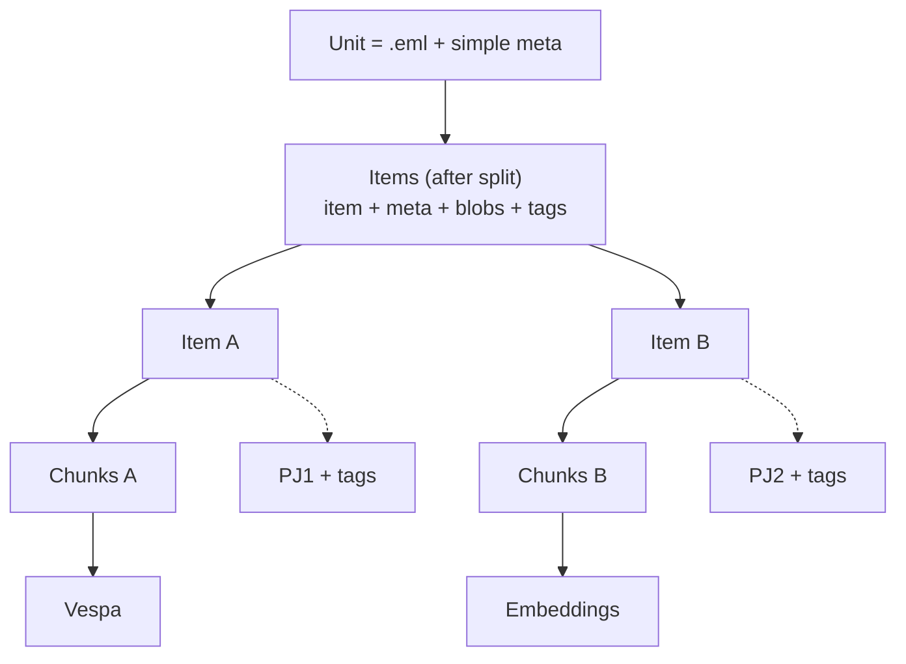
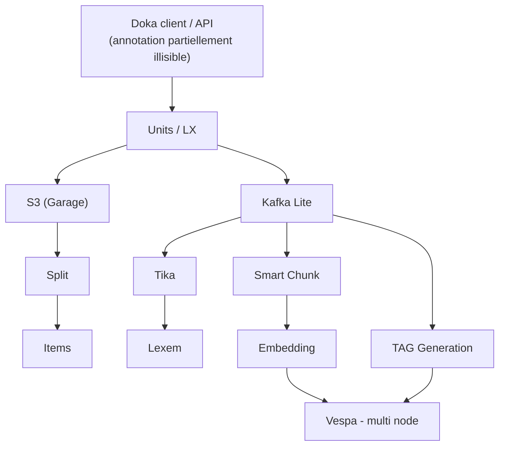

# Doka — transcription structurée de deux schémas manuscrits

> Reconstruction interprétative. Les flèches et certains libellés des originaux sont ambigus : les liens indiqués ci-dessous doivent être validés avant implémentation.

## 1. Modèle documentaire

Source : première image, avec les mentions `units`, `items`, `chunks`, `Vespa`, `embeddings`.

- `Unit` : annotation lisible « .eml + simple meta ».
- `Items` : annotation « after split » et « item + meta + blobs + tags ».
- Deux objets illustratifs A et B, avec des métadonnées.
- `PJ1` et `PJ2` : pièces jointes probables, avec tags ; leur rattachement exact est incertain.
- Les `chunks` sont dessinés en groupes sous les objets.
- En bas : « Vespa » et « embeddings ».
- En haut : « Ex: email + 2 PJ ».

### Diagramme Mermaid

## 2. Architecture de traitement

Source : seconde image.

- Point d'entrée : `Doka`, mention `Client: .../api/` (lecture incomplète).
- `Units` / `LX`.
- Stockage `S3 (Garage)`.
- Transport/événements `Kafka Lite`.
- `Split` → `Items`.
- Services `Tika`, `Lexem`, `Smart Chunk`, `Embedding`, `TAG Generation`.
- Destination indiquée : `Vespa - multi node`.

### Diagramme Mermaid

## Incertitudes à valider

1. Les flèches précises entre Kafka Lite, S3, Split et les traitements sont partiellement superposées sur le dessin.
2. Le libellé exact de l'API et le rôle de `LX` restent à confirmer.
3. `Lexem` et `TAG Generation` sont retranscrits phonétiquement / visuellement ; noms exacts à confirmer.
4. La distinction entre stockage de chunks dans Vespa et production d'embeddings mérite une précision.
5. Les annotations `PJ1`, `PJ2` et leurs métadonnées sont difficiles à lire.

Les SVG sont des reconstructions vectorielles et non des calques fidèles des traits manuscrits.
